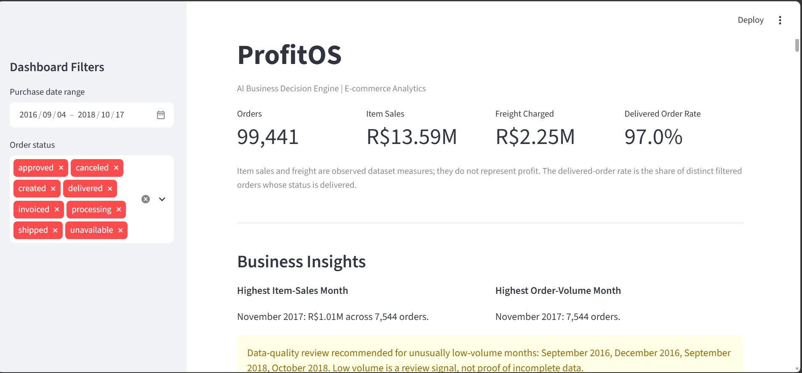
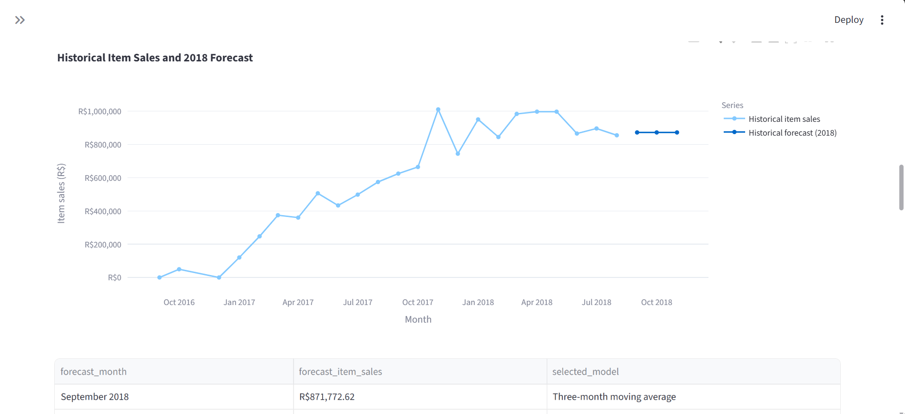
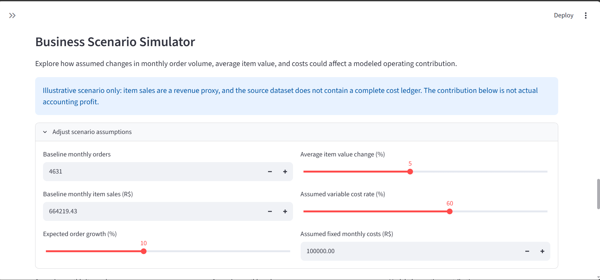

# ProfitOS — AI Business Decision Engine

ProfitOS is a data analytics and decision-support portfolio project built with Python, SQL, DuckDB, and Streamlit. It analyzes e-commerce performance, evaluates forecasting methods, and presents business insights through an interactive dashboard.

## Dashboard Preview

### Main Dashboard


### Sales Forecasting


### Business Scenario Simulator



## Key Features

- Monthly business KPI analysis
- E-commerce order and product-category analysis
- Payment and order-status analytics
- Data-quality inspection and validation
- DuckDB analytical warehouse and SQL queries
- Interactive Streamlit dashboard with filters and CSV exports
- Sales forecasting with rolling-origin backtesting
- Scenario simulation for business decision support

## Technology Stack

- Python, Pandas, NumPy
- SQL and DuckDB
- Statsmodels
- Streamlit and Plotly
- Pytest

## Forecasting Methodology

ProfitOS compares three forecasting methods:

1. Naive baseline
2. Three-month moving average
3. Holt-Winters additive-trend model

Models are evaluated using six rolling-origin validation windows, each with a three-month validation horizon. The model with the lowest average WAPE is selected provisionally.

### Historical Backtest Results

| Model | Average MAE | Average RMSE | Average WAPE |
|---|---:|---:|---:|
| Three-month moving average | 98,448.76 | 101,506.45 | 10.54% |
| Naive baseline | 107,057.32 | 116,607.46 | 11.49% |
| Holt-Winters | 153,626.51 | 167,139.67 | 16.80% |

The three-month moving average performed best across the tested windows. These results are historical diagnostics, not a guarantee of future accuracy.

## Data Quality and Limitations

This project uses the Brazilian Olist e-commerce dataset.

The current forecasting script trains through August 2018 and produces forecasts for September through November 2018. These are historical forecasts, not predictions for the current year.

A data audit found only 16 orders in September 2018 and four in October 2018. All four October orders were canceled. These unusually sparse months require investigation and should not be interpreted as normal demand.

Missing calendar months are currently filled with zero in the monthly time series. This assumption should be reviewed before using the model for business decisions.

The dataset and evaluation period are historical. Forecast accuracy on current or future business data has not been established.

## Project Structure

```text
profitos-decision-engine/
├── app/
│   └── app.py
├── data/
│   ├── raw/
│   ├── processed/
│   └── warehouse/
├── reports/
├── src/
│   └── profitos/
├── tests/
│   └── test_profit_os.py
├── requirements.txt
└── README.md
```

## Setup

Use Python 3.12 or another compatible Python version.

```powershell
python -m venv .venv
.\.venv\Scripts\Activate.ps1
python -m pip install -r requirements.txt
```

Ensure the required Olist CSV files are available in `data/raw/` and the processed dataset has been built before running analytics or forecasting.

## Run Forecasting

```powershell
python src/profitos/sales_forecast.py
```

The script generates:

- `reports/sales_forecast.csv`
- `reports/sales_forecast_metrics.csv`
- `reports/sales_forecast_backtests.csv`

## Run the Dashboard

```powershell
python -m streamlit run app/app.py
```

Open the local URL printed in the terminal.

## Run Tests

```powershell
python -m pytest -v
```

The current automated test suite contains six tests covering forecasting functions and metric calculations.

## Future Improvements

- Investigate sparse trailing months and source-data coverage.
- Expand rolling backtesting on reliable observations.
- Compare additional forecasting methods.
- Add end-to-end pipeline and data-quality tests.
- Evaluate performance on a separate holdout dataset.
- Improve forecast uncertainty reporting and decision thresholds.

## Disclaimer

ProfitOS is a portfolio and decision-support project. Its historical forecasts are illustrative and should not be treated as reliable predictions of current business performance.